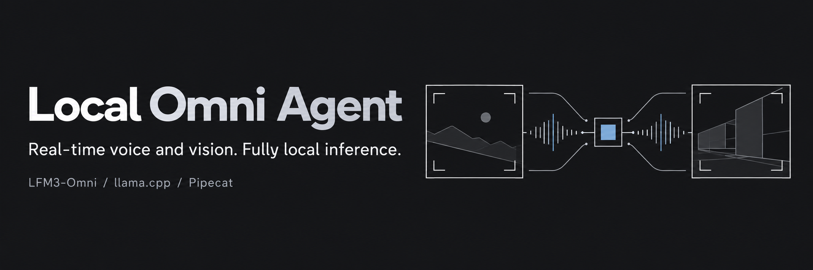
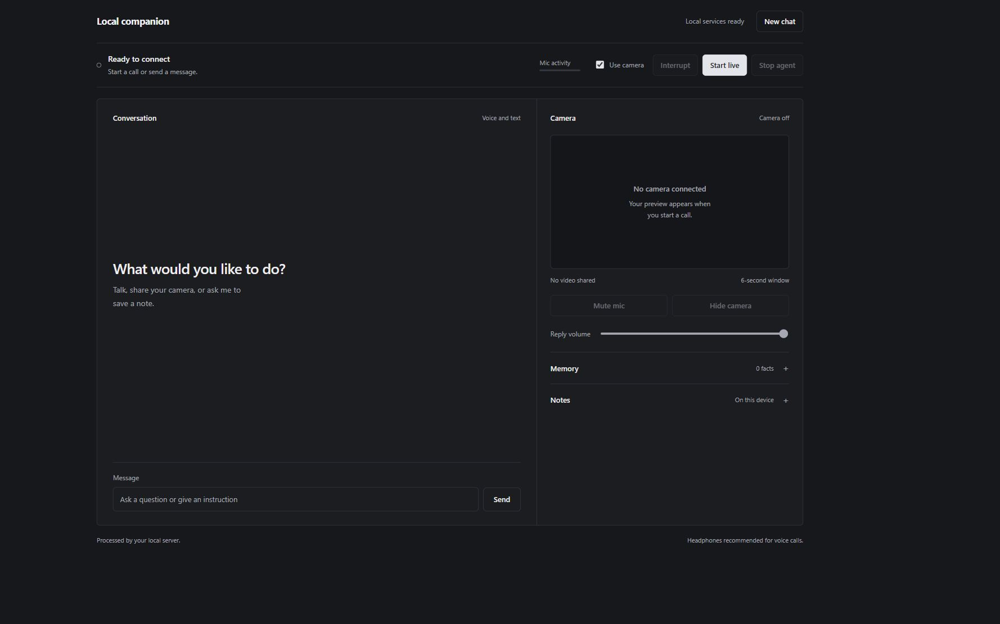
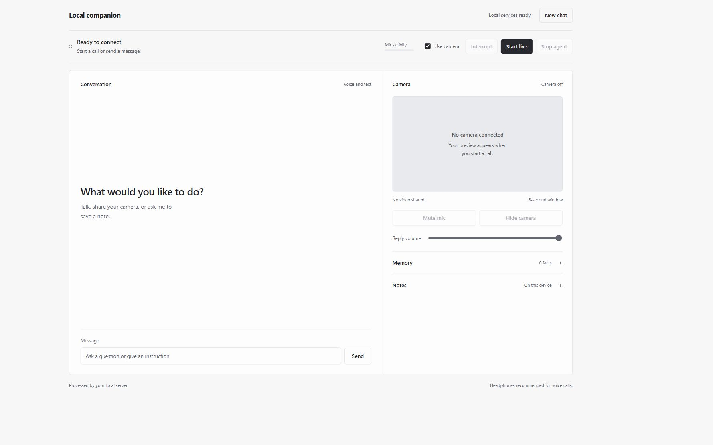
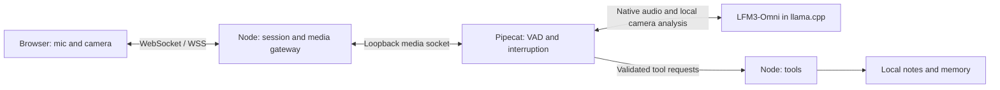

<p align="center"></p>



# Local Omni Agent

An experimental voice-and-vision agent built with **LFM3-Omni-2B, llama.cpp and Pipecat**. One native realtime session handles voice and typed requests, streams spoken replies, and uses visual context from webcam clips or image attachments. Inference runs locally.

This repository demonstrates a small working agent mechanism, not a production assistant or a benchmark. The supported launcher targets **Windows with an NVIDIA GPU**. Model weights and native binaries are downloaded separately and are not included here.

[Quick start](#quick-start) | [Architecture](docs/live-experiment.md) | [LAN access](docs/network.md) | [Verification](docs/live-verification.md)



<details>
<summary>Light appearance</summary>



</details>

## What you can try

- **Live voice and video.** Speak, see a local transcript, and ask about changes in the webcam view.
- **Spoken interruption.** Speak over a reply to cancel inference and flush playback. Use **Stop agent** to end the call and release the devices.
- **Small, useful actions.** Save Markdown notes and retain facts or preferences through two validated model tools.
- **Text and images.** During a call, type a question or attach a JPEG, PNG, or WebP. An attachment supplies the visual context for that turn in place of the webcam clip.
- **Optional LAN testing.** Use another device on your trusted local network through HTTPS. No cloud tunnel is required.

Try saying:

> What changed in the camera view?
>
> Save a note titled Shopping with the body: buy coffee.
>
> Remember that I prefer short answers.

## Quick start

### Requirements

- Windows and PowerShell **7.3+**.
- Node.js **22+**, [uv](https://docs.astral.sh/uv/getting-started/installation/) and Python **3.11**.
- A CUDA-capable NVIDIA GPU and current compatible drivers. The reference run used an 8 GB GPU; other hardware is not verified by this project.
- Several GB of free disk space, internet access for the initial downloads, and a microphone. Webcam optional.

The Python environment is isolated in `.venv` and pinned in `uv.lock`. There are no third-party npm runtime dependencies. After setup, the application makes no cloud inference calls.

```powershell
git clone https://github.com/varadganjoo/lfm3-omni-realtime-agent.git
cd lfm3-omni-realtime-agent
.\scripts\setup.ps1
.\scripts\start.ps1
```

Open **[http://127.0.0.1:8787/](http://127.0.0.1:8787/)** using this exact address. The setup script verifies pinned SHA-256 checksums before extracting the native runtime and synchronizes Python packages from the lockfile.

1. Choose whether to use the camera, then select **Start live**.
2. Allow microphone/camera access in the browser.
3. Speak or type a message. Use **Attach an image** for a still image. Interrupt a reply by speaking again, pressing **Interrupt**, or pressing **Escape**.
4. Select **Stop agent** when finished. Notes and memory remain saved.

Use headphones for the first test to reduce speaker echo triggering another turn. If one browser leaves a permission request pending or cannot load the local page, test another installed browser.

```powershell
.\scripts\stop.ps1   # stop the app, media service and model; free GPU memory
```

### Test from another device

```powershell
.\scripts\enable-lan.ps1
.\scripts\stop.ps1
.\scripts\start.ps1
```

The launcher prints your own HTTPS address and a certificate-help address. Camera/microphone access away from localhost requires a secure browser context. See [LAN setup and certificate trust](docs/network.md).

**LAN mode has no login.** Anyone on the configured subnet can use the instance and read or change its shared notes/memory. It is intended for a trusted home or lab network, not public internet hosting.

## Native voice and vision

Select **Start live** to speak or type to Local Companion. The app transcribes speech locally and uses the local LFM3 realtime session for replies. Enable **Use camera** to include a description of the recent clip.

The adapter executes tool calls before requesting a spoken confirmation. If a reply arrives as text alone, the adapter can ask the same session to speak it in a second response. [Native session behavior and limits](docs/native-voice.md).

## What “real time” means

Media flows continuously, but the model answers at turn boundaries:



Pipecat receives 16 kHz PCM audio and reduced JPEG frames at 2 fps. At a speech boundary, up to twelve recent frames become an ordered WebM clip covering the last six seconds. LFM3 transcribes the audio locally and analyzes the clip. The native session uses the transcript, audio and camera description to respond. Playback streams back through Pipecat.

A second inference slot on the same local model server analyzes the clip or attachment at the turn boundary. The realtime session receives the resulting description as text. Visual analysis can add several seconds before speech begins. [Implementation details](docs/live-experiment.md).

## Memory, actions and privacy

| Data | Location / behavior |
| --- | --- |
| Notes | `data/notes/*.md`, with server-generated filenames |
| Learned facts | `data/memory.json`, editable through corrections and **Forget** |
| Conversation | Native model session context, held for the duration of the call |
| Audio/video | Bounded in-memory buffers; the app does not save recordings |
| Internal service key and TLS files | Generated under `runtime/`, excluded from Git |

For memory, say “Remember that…” or type “Remember: …”. The model suggests a label, and the server extracts the fact from your current typed request or speech transcript. Review the saved text for transcription errors. An interruption leaves completed writes in place.

## Current limits

- One live call with two local inference slots for the realtime session and media processing.
- Twenty seconds of audio per spoken turn, six seconds of camera history, and a 30-minute media session.
- An 8,192-token context per slot, bounded tool iterations and bounded uploads.
- Two tools: `save_note` and `remember_fact`. No shell, browser automation or arbitrary file access.
- Notes and memories are shared within the instance. Browser sessions are not separate user accounts.
- The Windows/CUDA launcher is the supported setup. Linux/macOS launchers, physical-phone live-call coverage, echo calibration and broad adversarial evaluation remain open work.

## Development and tests

### Repository layout

```text
src/
  server/       Node HTTP/media gateway, tool validation and local storage
  media/        Python Pipecat pipeline, audio/video buffers and protocol
  web/          Browser interface and microphone/camera capture
scripts/        Windows launchers, setup and verification tools
tests/          JavaScript and Python unit tests
docs/           Architecture, LAN setup, verification and project artwork
```

Generated `runtime/`, `models/`, `data/` and `.venv/` directories stay at the project root and are excluded from Git. Run the commands below from the project root; the Windows launchers also resolve their paths independently of your current folder.

### Run checks

```powershell
npm test
.\.venv\Scripts\python.exe -m unittest discover -s tests -p 'test_*.py' -v
```

With the local services running:

```powershell
.\.venv\Scripts\python.exe scripts/access_smoke.py
.\scripts\make-test-audio.ps1
.\.venv\Scripts\python.exe scripts/live_smoke.py
# Optional, after enabling LAN:
.\.venv\Scripts\python.exe scripts/lan_smoke.py
.\.venv\Scripts\python.exe scripts/live_smoke.py --lan
```

The live test uses generated color frames and locally synthesized speech. It checks video order, streamed speech, interruption, stale-audio rejection and note title/body. It also verifies explicit memory writes and cleans up its synthetic notes and memory. [Verification scope](docs/live-verification.md).

Before publishing your own fork or diagnostics, review staged files, run `npm run check:publication`, and scan for secrets. Do not publish real recordings, runtime keys, certificates, notes, memory or personal attachments. See [security and privacy](SECURITY.md) and [contributing](CONTRIBUTING.md).

## Upstream projects and licenses

- [Liquid AI LFM3-Omni-2B](https://huggingface.co/LiquidAI/LFM3-Omni-2B), with [GGUF inference instructions](https://huggingface.co/LiquidAI/LFM3-Omni-2B-GGUF).
- [llama.cpp b12021](https://github.com/ggml-org/llama.cpp/releases/tag/b12021), with [server API documentation](https://github.com/ggml-org/llama.cpp/blob/b12021/tools/server/README.md).
- [Pipecat](https://github.com/pipecat-ai/pipecat), using its [FastAPI WebSocket transport](https://github.com/pipecat-ai/pipecat/blob/v1.15.0/src/pipecat/transports/websocket/fastapi.py).

Application code and project artwork: [MIT](LICENSE). Model weights use the **LFM Open License v1.0**, separately from this repository. [Third-party notices](THIRD_PARTY_NOTICES.md).
